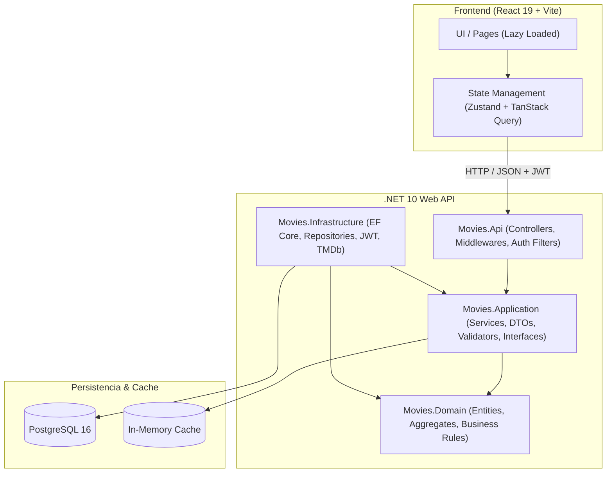
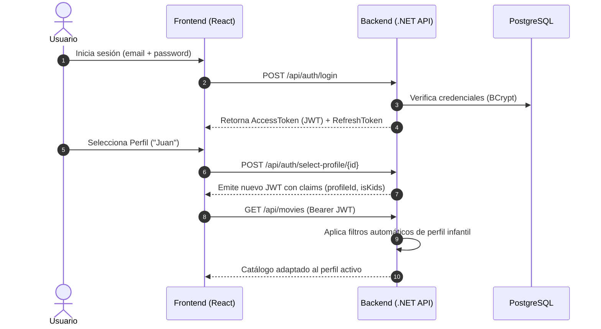

# Streamify — Modern Full Stack Streaming Platform

[](https://github.com)
[](https://dotnet.microsoft.com/)
[](https://react.dev/)
[](https://www.typescriptlang.org/)
[](https://www.postgresql.org/)
[](https://www.docker.com/)

**Streamify** es una plataforma de streaming y catálogo audiovisual full-stack inspirada en la experiencia de usuario de Netflix, diseñada siguiendo los principios de **Clean Architecture**, **Domain-Driven Design (DDD)** y las mejores prácticas de **React 19** y **.NET 10**.

---

## 🌟 Características Destacadas

- **Gestión Multi-Perfil ("Who is watching?")**:
  - Hasta 5 perfiles por cuenta con avatares independientes y listas de seguimiento personalizadas (*My List*).
  - Modal interactivo para creación instantánea de perfiles y resolución de bloqueos de sesión.
- **Modo Infantil Certificado (`isKids`)**:
  - Filtrado estricto a nivel de base de datos que excluye automáticamente géneros de terror, crimen, violencia o adultos.
  - Indicador visual distintivo (*Kids Mode badge*) en la barra de navegación y en el menú de usuario.
- **Buscador Instantáneo con Command Palette (`Ctrl + K` / `⌘K`)**:
  - Diálogo de búsqueda global con *debounce* (300 ms), navegación por teclado, calificaciones por estrellas y miniaturas.
  - Endpoint dedicado de alto rendimiento (`GET /api/movies/search`).
- **Reproductor Modal de Video y Trailers**:
  - Integración con trailers de YouTube embebidos y soporte para reproducción directa de video HTML5 en relación 16:9 cinematográfica.
  - Cierre con tecla `Escape`, control de foco y pausa inmediata al cerrar para evitar reproducción en segundo plano.
- **Rendimiento y Caching en Memoria**:
  - Caching en memoria (`IMemoryCache`) para la película destacada (*Hero Movie*) y reducción de consultas redundantes con tiempos de respuesta menores a **1 ms**.
  - División de código en frontend (*code-splitting*) con `React.lazy()` y `<Suspense>`, reduciendo el bundle principal de 858 kB a **226 kB**.
- **Panel de Administración Completo**:
  - Backoffice protegido por roles (`admin`) para la gestión integral del catálogo de películas, géneros y usuarios con `TanStack Table`.
- **Autenticación Robusta**:
  - Tokens JWT de corta duración (15 min) + rotación de *Refresh Tokens* persistidos en base de datos.
  - Hash seguro de contraseñas mediante **BCrypt**.

---

## 🏛️ Arquitectura del Sistema

El backend está estructurado en 4 capas estrictamente desacopladas para maximizar la testabilidad y la mantenibilidad:



### Flujo de Seguridad y Autorización (JWT + Refresh Tokens)



---

## 🛠️ Stack Tecnológico

| Capa | Tecnología | Propósito |
| :--- | :--- | :--- |
| **Backend** | .NET 10 / C# 13 | API REST de alto rendimiento y bajo consumo de recursos. |
| **ORM** | Entity Framework Core 10 | Acceso a datos tipado, migraciones automáticas y consultas LINQ. |
| **Testing** | xUnit, Moq, FluentAssertions | Pruebas unitarias de servicios de aplicación y reglas de negocio. |
| **Frontend** | React 19, TypeScript 5.9, Vite | Interfaz moderna, reactiva y tipada de extremo a extremo. |
| **Estilos & UI** | Tailwind CSS v4, Radix UI, Lucide | Sistema de diseño oscuro y componentes accesibles. |
| **Estado Cliente** | Zustand + TanStack Query v5 | Gestión de sesión global y sincronización con caché del servidor. |
| **Contenedores** | Docker, Docker Compose, Nginx | Empaquetado portable de producción y proxy inverso. |
| **CI/CD** | GitHub Actions | Pipeline de validación continua (build, test, lint). |

---

## 🚀 Inicio Rápido

### Opción 1: Con Docker Compose (Recomendada - 1 comando)

No necesitas instalar .NET ni Node.js en tu equipo. Solo requieres [Docker Desktop](https://www.docker.com/products/docker-desktop/):

```bash
# 1. Clonar el repositorio
git clone https://github.com/tu-usuario/streamify.git
cd streamify

# 2. Levantar la aplicación completa (DB + Backend + Frontend)
docker compose up --build
```

- **Frontend**: Abre [http://localhost](http://localhost) en tu navegador.
- **Backend API**: Disponible en [http://localhost:5000/api](http://localhost:5000/api).

---

### Opción 2: Ejecución Local en Modo Desarrollo

#### 1. Backend (.NET 10)
```bash
cd backend/Backend-Movies
# Configura tu conexión en appsettings.Development.json o variables de entorno
dotnet restore
dotnet run
```
*La API se ejecutará en `http://localhost:5000` o `https://localhost:7001`.*

#### 2. Frontend (React 19)
```bash
cd frontend
npm install
npm run dev
```
*La aplicación web se ejecutará en `http://localhost:5173`.*

---

## 🔑 Credenciales de Demostración

La base de datos se inicializa automáticamente con los siguientes usuarios de prueba:

| Rol | Correo Electrónico | Contraseña | Descripción |
| :--- | :--- | :--- | :--- |
| **Administrador** | `admin@movies.com` | `Admin1234!` | Acceso completo al panel `/admin` (gestión de películas y usuarios). |
| **Usuario Regular** | *Registra cualquier cuenta nueva* | *Tu contraseña* | Creación de perfiles ilimitada, listas personalizadas y modo niños. |

---

## 🧪 Pruebas Automatizadas y Calidad de Código

El repositorio cuenta con verificación estricta tanto en backend como en frontend:

```bash
# Ejecutar pruebas unitarias de backend
cd backend
dotnet test

# Ejecutar análisis estático de frontend (0 errores garantizados)
cd frontend
npm run lint

# Compilar frontend verificando tipos y code-splitting
npm run build
```

---

## 📐 Decisiones de Ingeniería Clave

1. **¿Por qué Zustand + TanStack Query en lugar de Redux?**  
   Zustand maneja el estado del cliente que debe ser persistente (sesión, perfil activo) con cero boilerplate, mientras que TanStack Query gestiona el estado asíncrono del servidor (películas, géneros, listas) con revalidación en segundo plano y caché inteligente.

2. **¿Por qué Cookies HttpOnly y Refresh Tokens rotativos?**  
   Almacenar tokens de larga duración en `localStorage` deja la aplicación vulnerable a ataques XSS. Con tokens de acceso JWT de 15 minutos en memoria y refresh tokens protegidos, se mitiga el impacto de un token comprometido.

3. **¿Por qué Clean Architecture con .NET 10?**  
   La lógica de negocio (`Movies.Application`) no conoce detalles de infraestructura ni librerías de persistencia, facilitando cambiar PostgreSQL por otra base de datos o reemplazar integraciones externas (como TMDb) sin tocar una sola regla de negocio.

---

## 📄 Licencia

Este proyecto está bajo la Licencia MIT. Consulta el archivo `LICENSE` para más información.
